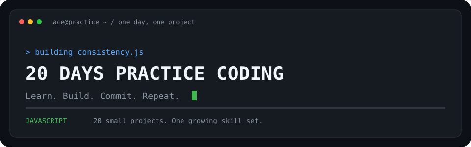

  

# 20 Days Practice Coding

A personal JavaScript challenge by **Ace Toleza**: practice one project each day and build consistency through small, steady steps.

**JavaScript · HTML · CSS**

## The challenge

- Practice one coding exercise each day.
- Keep each project in its own numbered folder.
- Commit each day's work with a clear message.

## Daily progress

Update the checkboxes as each day's project is uploaded.

- [x] Day 01 — [Calculator](./01-calculator/)
- [x] Day 02 — [Even or odd](./02-even-or-odd/)
- [x] Day 03 — Largest number
- [ ] Day 04 — Reverse text
- [ ] Day 05 — Palindrome checker
- [ ] Day 06 — Factorial
- [ ] Day 07 — Times table
- [ ] Day 08 — Vowel counter
- [ ] Day 09 — Temperature
- [ ] Day 10 — Remove duplicates
- [ ] Day 11 — Number sorter
- [ ] Day 12 — Sum it up
- [ ] Day 13 — Even numbers
- [ ] Day 14 — Prime checker
- [ ] Day 15 — Fibonacci
- [ ] Day 16 — Word counter
- [ ] Day 17 — Percentage
- [ ] Day 18 — Item frequency
- [ ] Day 19 — Countdown
- [ ] Day 20 — Random number

## Run a project

Open a project folder in VS Code. For projects with an `index.html` file, open it in your browser or use Live Server. For standalone JavaScript exercises, follow that project's input and runtime requirements.

---

**One day. One project. Keep going.**
